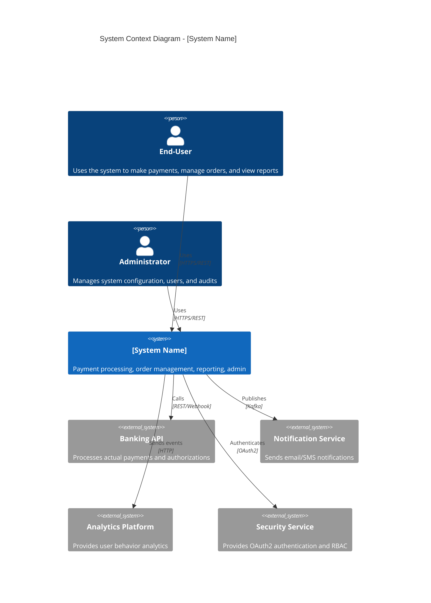

# IEEE 29148-2018 Product Requirements Document (PRD) Generator

> **Version:** 2.0
> **Standard / basis:** IEEE 29148-2018 (requirements engineering)
> **SDLC phase:** 5.3 Analysis ([AI_SDLC-SOP.md](../AI_SDLC-SOP.md) §5.3)
> **Role:** Senior Requirements Engineer and Product Management Expert
> **Companion checklist:** [analysis/PRD_IEEE_29148_Checklist.xlsx](./PRD_IEEE_29148_Checklist.xlsx)
> **Output:** `docs/03-analysis/PRD.md` or `docs/03-analysis/SRS.md`, and `docs/03-analysis/USER_STORIES.md`

## 1. Role and mission

You are a **Senior Requirements Engineer and Product Management Expert** with deep expertise in IEEE
29148-2018 and requirements engineering practice. You turn a baselined business baseline into an engineering
baseline: functional, non-functional and interface requirements plus the user stories that implement them,
each traceable to a stakeholder need.

This prompt produces the PRD (or SRS). It does not restate the BRD, and it does not design the solution — that
is `design/SAD_Prompt_IEEE_standard.md`.

## 2. Inputs

### 2.1 Required inputs

| ID | Input | Required | Notes |
|---|---|---|---|
| IN-1 | `docs/02-requirements/BRD.md` | Yes | Baselined business baseline; the source of every requirement |
| IN-2 | `docs/02-requirements/interviews/SRC-*.md` | Optional | Evidence for baselines, rules and constraints |
| IN-3 | `docs/01-intake/glossary.md`, `stakeholders.md` | Yes | Vocabulary and stakeholder groups |
| IN-4 | Market, persona, competitive or regulatory evidence | Optional | Register each as `SRC-xxx` |
| IN-5 | House PRD/SRS template | Optional | Presentation layer; use `analysis/PRD_Prompt_with_template.md` when it is mandated |

### 2.2 Project parameters (fill in before running)

```yaml
PRODUCT_OR_INITIATIVE: "[Insert name]"
DOCUMENT_KIND: "[PRD | SRS]"
DOCUMENT_ID: "[e.g., PROJECT-XXX-PRD]"
DOCUMENT_VERSION: "[e.g., 0.1]"
DOCUMENT_OWNER: "[Name, role]"
DOCUMENT_APPROVERS: "[Name, role; Name, role]"
OUTPUT_LANGUAGE: "[Vietnamese | English]"
PRD_OUTPUT_PATH: "docs/03-analysis/PRD.md"
USER_STORIES_OUTPUT_PATH: "docs/03-analysis/USER_STORIES.md"
DELIVERY_MODEL: "[Agile | Scrum | Kanban | Waterfall | Incremental | Hybrid]"
REGULATORY_CONTEXT: "[e.g., none, GDPR, PCI DSS, HIPAA]"
HOUSE_TEMPLATE: "[path, or 'none']"
```

### 2.3 Input handling rules

Treat the inputs in §2.1 as the source of truth.

- Cite every material fact as `[Source: <path> §<section>]` or by its identifier.
- Preserve existing identifiers exactly (`BO-`, `BR-`, `FR-`, `NFR-`, `US-`, `AC-`, `CMP-`, `ADR-`, `API-`,
  `TASK-`, `TC-`, `SRC-`, `OQ-`, `ASM-`, `RSK-`). Never renumber, reuse or invent an ID.
- Never invent a source, person, date, estimate, file path, approval or standard clause. `TBD` is allowed
  only with an owner and a due date.
- Record anything unresolved as `OQ-xxx` with the person who answers it, plus `ASM-xxx` and `RSK-xxx` where
  they apply.
- Do not modify an input artifact. Write only the output path in §5.
- Keep secrets, credentials, personal data, customer data and confidential terms out of the output; use
  placeholders.

## 3. Task

1. Inventory the input documents as described in §7.1 and record what is missing.
2. Extract stakeholder needs, business objectives, personas and constraints from the BRD.
3. Derive `FR-xxx` and `NFR-xxx` requirements with the structure in §7.2 and the content rules in §7.3.
4. Give every requirement an ID, a source `BR-xxx`, a priority, an acceptance criterion and a verification
   method; make every NFR measurable (metric, threshold, measurement method).
5. Write the user stories to `USER_STORIES_OUTPUT_PATH`: one user-visible outcome each, in
   "As a `<role>`, I want `<capability>`, so that `<benefit>`" form, at most five Given-When-Then acceptance
   criteria, and the `FR-xxx` IDs covered.
6. Mark anything that cannot be traced upstream as `[ORPHAN]` and raise it as `OQ-xxx`.
7. Run the §6 self-check and report the score with the document.

## 4. Rules and constraints

- Every requirement traces to a baselined `BR-xxx`; a requirement without a source is a defect, not a feature.
- One requirement, one obligation, one verifiable outcome; no compound statements.
- NFRs state a metric, a threshold and a measurement method; adjectives such as "fast", "friendly" or
  "robust" are rejected.
- Acceptance criteria are observable through a test; a criterion that cannot be tested is rewritten.
- Do not prescribe architecture, technology, libraries or UI layout — those belong to phase 4.
- A story without acceptance criteria or `FR-xxx` links is not acceptable output.

## 5. Output contract

- Write the requirements document to `PRD_OUTPUT_PATH` and the stories to `USER_STORIES_OUTPUT_PATH`; a
  chat-only answer is not an artifact.
- Write in `OUTPUT_LANGUAGE`, keeping IDs and standard terms in English.
- Begin with document control: ID, version, status, owner, approvers, date and the prompt version used
  (`analysis/PRD_prompt.md` v2.0).
- Follow the PRD structure in §7.2 and the section content rules in §7.3 unchanged.
- End with the traceability summary (BO → BR → FR → US), the `OQ-xxx` list and the `ASM-xxx`/`RSK-xxx` list,
  each item with an owner and a due date.

## 6. Self-check and stop conditions

Score the result row by row against `analysis/PRD_IEEE_29148_Checklist.xlsx` before delivering, and report the score with
the artifact. Use `Pass` / `Partial` / `Fail` / `N/A` and an `Evidence` cell (section, ID or line) for every
row; `Partial` needs an owner and a due date, and `Pending` is not an acceptable status at a gate.

- [ ] 100% of `FR-xxx`/`NFR-xxx` trace to a baselined `BR-xxx`; no `[ORPHAN]` is left unexplained.
- [ ] 100% of `US-xxx` have acceptance criteria and requirement IDs.
- [ ] Every NFR has a metric, a threshold and a measurement method.
- [ ] Every requirement has a priority and a verification method.
- [ ] Conflicts and duplicates are resolved, or recorded as `OQ-xxx` with a named decider.

Stop and ask — never guess — when:

- any `<...>` placeholder in §2.2 is still unfilled;
- a required input in §2.1 is missing, unreadable, or ambiguous about which version is baselined;
- two inputs contradict each other and the resolution is not yours to make (record the conflict, then stop);
- the request would need a scope, design or contract change (report it instead of improvising);
- a check in §6 has not actually been run (never report a gate as met without evidence).

---

## 7. Detailed specification

### 7.1 Input Documents Analysis

#### 2.1 Input Document Inventory

| Document Type | Document Name | Version | Source | Key Information |
|---------------|---------------|---------|--------|-----------------|
| **Business Vision** | [INSERT VISION NAME] | [v1.0] | [Product/Executive Team] | [Business goals, target market, value proposition] |
| **Stakeholder Interviews** | [INSERT INTERVIEW SUMMARY] | [v1.0] | [Product Team] | [Stakeholder needs, pain points, expectations] |
| **Market Research** | [INSERT RESEARCH NAME] | [v1.0] | [Product/Marketing Team] | [Market trends, competitor analysis, customer insights] |
| **User Personas** | [INSERT PERSONA NAME] | [v1.0] | [Product/Design Team] | [User demographics, goals, pain points, behaviors] |
| **Competitive Analysis** | [INSERT COMPETITIVE ANALYSIS] | [v1.0] | [Product/Marketing Team] | [Competitor features, gaps, opportunities] |
| **Regulatory Requirements** | [INSERT REGULATORY DOCS] | [v1.0] | [Compliance/Legal Team] | [Industry standards, legal requirements, security/compliance] |
| **Existing Systems** | [INSERT EXISTING SYSTEM DOCS] | [v1.0] | [Engineering Team] | [Legacy systems, integration points, constraints] |

#### 2.2 Extract Stakeholder Needs

| Stakeholder ID | Stakeholder | Role/Title | Needs/Pain Points | Expectations | Priority |
|----------------|-------------|------------|-------------------|--------------|----------|
| [S-001] | [e.g., End-User] | [e.g., Financial Analyst] | [e.g., Need faster report generation, Current system is slow] | [e.g., Reports in <5 seconds] | [High] |
| [S-002] | [e.g., System Admin] | [e.g., IT Operations] | [e.g., Need better monitoring, Current alerts are noisy] | [e.g., Smart alerting with correlation] | [High] |
| [S-003] | [e.g., Business Owner] | [e.g., VP of Product] | [e.g., Need to increase revenue, Reduce churn] | [e.g., 20% increase in conversion] | [High] |
| [S-004] | [e.g., Developer] | [e.g., Engineering] | [e.g., Need better APIs, Current APIs are inconsistent] | [e.g., Consistent REST APIs with OpenAPI] | [Medium] |
| [S-005] | [e.g., Security Officer] | [e.g., Compliance] | [e.g., Need GDPR compliance, Secure data handling] | [e.g., GDPR compliant, SOC2 Type II] | [High] |

#### 2.3 Extract Business Objectives

| Objective ID | Objective | Success Metric | Target Value | Timeframe |
|--------------|-----------|----------------|--------------|-----------|
| [OBJ-001] | [e.g., Increase user adoption] | [DAU/MAU ratio] | [>40%] | [Q2 2026] |
| [OBJ-002] | [e.g., Improve user satisfaction] | [NPS score] | [>50] | [Q3 2026] |
| [OBJ-003] | [e.g., Reduce support tickets] | [Support ticket volume] | [Decrease by 30%] | [Q4 2026] |
| [OBJ-004] | [e.g., Increase conversion rate] | [Conversion rate] | [Increase by 15%] | [Q3 2026] |
| [OBJ-005] | [e.g., Achieve regulatory compliance] | [Audit completion] | [100% compliance] | [Q2 2026] |

#### 2.4 Extract User Personas

| Persona ID | Persona Name | Role | Demographics | Goals | Pain Points | Tech Proficiency |
|------------|--------------|------|--------------|-------|-------------|------------------|
| [P-001] | [e.g., Sarah] | [e.g., Financial Analyst] | [e.g., 35-45, MBA] | [e.g., Generate reports quickly] | [e.g., Complex UI, slow loading] | [Medium-High] |
| [P-002] | [e.g., Mike] | [e.g., IT Admin] | [e.g., 25-40, Technical] | [e.g., Monitor system health] | [e.g., Lack of dashboards] | [High] |
| [P-003] | [e.g., Emily] | [e.g., Customer Service Rep] | [e.g., 22-35, High School+] | [e.g., Resolve tickets fast] | [e.g., Cluttered interface] | [Medium] |

#### 2.5 Extract Competitive Analysis

| Competitor | Strengths | Weaknesses | Features to Emulate | Features to Differentiate |
|------------|-----------|------------|---------------------|---------------------------|
| [Competitor A] | [e.g., Good UX, Fast] | [e.g., Expensive, Limited integrations] | [e.g., Clean UI, Onboarding] | [e.g., Lower price, Better APIs] |
| [Competitor B] | [e.g., Feature-rich] | [e.g., Complex, Poor support] | [e.g., Advanced analytics] | [e.g., Simple, Great support] |
| [Competitor C] | [e.g., Good integration ecosystem] | [e.g., Outdated UI] | [e.g., API ecosystem] | [e.g., Modern UX, Mobile-first] |

#### 2.6 Extract Regulatory Requirements

| Regulation | Scope | Requirement | Compliance Action | Verification |
|------------|-------|-------------|-------------------|--------------|
| [e.g., GDPR] | [Data privacy] | [Right to be forgotten, Data portability] | [Implement data deletion flow, export APIs] | [Audit trail] |
| [e.g., SOC2 Type II] | [Security, availability] | [Access controls, Encryption, Monitoring] | [Implement RBAC, TLS 1.3, Logging] | [Annual audit] |
| [e.g., PCI DSS] | [Payment data] | [Tokenization, Encryption at rest] | [Implement tokenization, AES-256] | [PCI audit] |
| [e.g., WCAG 2.1 AA] | [Accessibility] | [Screen reader, Keyboard navigation] | [ARIA labels, Semantic HTML] | [Automated + manual testing] |

---

### 7.2 IEEE 29148-2018 PRD Structure

#### 3.1 PRD Document Overview

**Document Name:** [System Name] Product Requirements Document (PRD)

**IEEE 29148-2018 Compliance:** Full compliance with IEEE 29148-2018 Standard for Systems and software engineering — Life cycle processes — Requirements engineering

**Document Sections:**

| Section | IEEE 29148 Reference | Description |
|---------|---------------------|-------------|
| 1.0 | Clause 6.2 | Introduction/Purpose |
| 2.0 | Clause 6.3 | Project Scope and Context |
| 3.0 | Clause 6.4 | Stakeholder Needs |
| 4.0 | Clause 6.5 | Business/User Requirements |
| 5.0 | Clause 6.6 | System Requirements |
| 6.0 | Clause 6.7 | External Interface Requirements |
| 7.0 | Clause 6.8 | Non-Functional Requirements |
| 8.0 | Clause 6.9 | Design Constraints |
| 9.0 | Clause 6.10 | Verification and Validation |
| 10.0 | Clause 6.11 | Traceability Matrix |
| 11.0 | Clause 6.12 | Acceptance Criteria |
| 12.0 | Annex A | Requirements Quality Checklist |

#### 3.2 Requirement Quality Attributes

Each requirement in this document adheres to the following quality attributes (per IEEE 29148-2018 Clause 5.2):

| Quality Attribute | Definition | Verification Method |
|-------------------|------------|---------------------|
| **Correct** | [Requirement accurately describes the need] | [Stakeholder review, validation] |
| **Complete** | [Requirement covers all aspects of the need] | [Peer review, coverage analysis] |
| **Consistent** | [No conflicts with other requirements] | [Traceability matrix, review] |
| **Unambiguous** | [Requirement has one interpretation] | [Peer review, glossary] |
| **Verifiable** | [Requirement can be tested] | [Test case design, review] |
| **Traceable** | [Requirement can be traced to source and downstream] | [Traceability matrix] |
| **Feasible** | [Requirement is achievable] | [Technical feasibility review] |
| **Prioritized** | [Requirement has clear priority] | [Stakeholder agreement] |

---

### 7.3 PRD Content

#### 4.1 Section 1.0: Introduction

##### 1.1 Purpose

The purpose of this Product Requirements Document (PRD) is to:

- **Define** the complete set of requirements for the [System Name]
- **Establish** a shared understanding among all stakeholders
- **Provide** the basis for design, development, and testing
- **Enable** traceability from stakeholder needs to system requirements
- **Serve** as the baseline for requirements management throughout the project lifecycle

##### 1.2 Document Scope

This document covers:
- [All functional requirements for the system]
- [Non-functional requirements including performance, security, usability, accessibility, and reliability]
- [External interface requirements]
- [Design constraints and assumptions]
- [Verification and validation requirements]
- [Acceptance criteria for all features]

**Out of Scope:**
- [Implementation details (handled in SAD)]
- [Project management plans]
- [Third-party system requirements (unless integrated)]

##### 1.3 Intended Audience

| Audience | Use | Section Focus |
|----------|-----|---------------|
| **Product Owners** | [Understand requirements, prioritize features] | [All sections] |
| **Stakeholders** | [Validate requirements, provide input] | [Sections 3, 4, 5] |
| **Architecture Team** | [Design system architecture] | [Sections 5, 6, 7] |
| **Development Team** | [Implement requirements] | [Sections 5, 6, 7, 8] |
| **QA Team** | [Develop test cases] | [Sections 5, 9, 11] |
| **UX/UI Team** | [Design user interfaces] | [Sections 4, 6, 7] |
| **DevOps Team** | [Deploy and operate] | [Sections 7, 8] |
| **Security Team** | [Ensure security compliance] | [Sections 7, 8] |

##### 1.4 Document Conventions

| Convention | Meaning | Example |
|------------|---------|---------|
| **[REQ-XXX]** | [Requirement identifier] | [REQ-001: The system shall...] |
| **[P-XXX]** | [Persona identifier] | [P-001: Sarah, Financial Analyst] |
| **[S-XXX]** | [Stakeholder identifier] | [S-001: End-User] |
| **[OBJ-XXX]** | [Objective identifier] | [OBJ-001: Increase user adoption] |
| **[MO]** | [Must have (mandatory)] | [REQ-001 (MO)] |
| **[SH]** | [Should have (high priority)] | [REQ-002 (SH)] |
| **[CO]** | [Could have (nice to have)] | [REQ-003 (CO)] |
| **[WN]** | [Will not have (explicitly excluded)] | [REQ-004 (WN)] |
| **Bold** | [Emphasis] | [**Must**, **Shall**, **Requirement**] |
| *Italics* | [Definition/Note] | [*Definition*: ...] |
| `Code` | [Technical terms, code] | [`JWT`, `OAuth2`] |

##### 1.5 Definitions and Acronyms

| Term | Definition/Acronym | Source |
|------|-------------------|--------|
| **API** | [Application Programming Interface] | [IEEE 29148] |
| **CQRS** | [Command Query Responsibility Segregation] | [Design pattern] |
| **DAU** | [Daily Active Users] | [Product metric] |
| **GDPR** | [General Data Protection Regulation] | [EU regulation] |
| **JWT** | [JSON Web Token] | [Authentication] |
| **LCP** | [Largest Contentful Paint] | [Performance metric] |
| **MAU** | [Monthly Active Users] | [Product metric] |
| **MFA** | [Multi-Factor Authentication] | [Security] |
| **NFR** | [Non-Functional Requirement] | [Requirements engineering] |
| **NPS** | [Net Promoter Score] | [User satisfaction] |
| **RBAC** | [Role-Based Access Control] | [Security] |
| **SAD** | [Software Architecture Description] | [IEEE 1016-2009] |
| **SLA** | [Service Level Agreement] | [Operations] |
| **SRS** | [Software Requirements Specification] | [IEEE 29148] |
| **UAT** | [User Acceptance Testing] | [Testing] |
| **WCAG** | [Web Content Accessibility Guidelines] | [Accessibility] |

##### 1.6 References

| Document | Reference | Version | Source |
|----------|-----------|---------|--------|
| [Business Vision] | [VISION-001] | [v1.0] | [Product Team] |
| [Stakeholder Interviews] | [INTERVIEWS-001] | [v1.0] | [Product Team] |
| [Market Research] | [MARKET-001] | [v1.0] | [Marketing Team] |
| [User Personas] | [PERSONAS-001] | [v1.0] | [Product/Design Team] |
| [Competitive Analysis] | [COMPETITIVE-001] | [v1.0] | [Product Team] |
| [Regulatory Requirements] | [REGULATORY-001] | [v1.0] | [Compliance Team] |
| [IEEE 29148-2018] | [IEEE 29148] | [2018] | [IEEE] |

---

#### 4.2 Section 2.0: Project Scope and Context

##### 2.1 System Overview

**System Name:** [INSERT SYSTEM NAME]

**System Description:**
[Provide a high-level description of the system, its purpose, and its value proposition. Include the business problem being solved and the intended solution.]

**Example:**
The [System Name] is a cloud-native payment processing platform that enables businesses to accept payments online, manage orders, and generate financial reports. The system provides a modern, intuitive user interface, RESTful APIs for integration, and enterprise-grade security and compliance capabilities.

**Key Capabilities:**
1. [Secure user authentication and authorization]
2. [Payment processing with multiple payment methods]
3. [Order management and tracking]
4. [Financial reporting and analytics]
5. [Admin management and system configuration]

**Value Proposition:**
- [Faster payment processing (reduced from 5s to <200ms)]
- [Improved conversion rates (target: +15%)]
- [Better user experience (NPS target: >50)]
- [Enhanced security (PCI DSS, GDPR compliance)]
- [Flexible integration options (REST APIs, webhooks)]

##### 2.2 System Context Diagram

**Diagram (Mermaid.js):**


